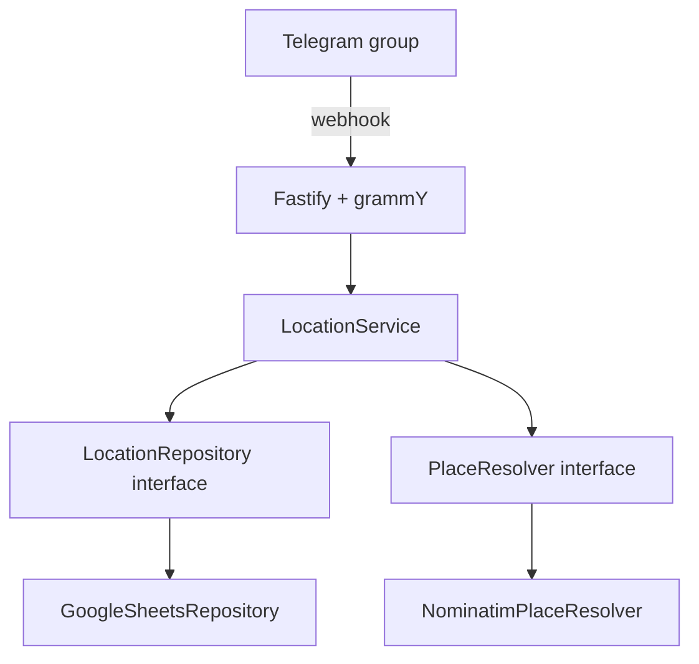

# Telegram-бот для отметок путешественников — PRD + Architecture

**Версия:** 1.0 · **Дата:** 2026-11-09 · **Статус:** согласованная спецификация MVP  
**Цель документа:** передать Codex все продуктовые и технические требования в одном файле без отдельного PRD и Architecture Decision Record.

## 1. Идея и цели

В одной Telegram-группе путешественников участник пишет `/set Берлин, Германия`. Бот проверяет название населённого пункта через Nominatim, определяет город, страну и примерные координаты центра города, сохраняет актуальную отметку пользователя и добавляет запись в историю. Команда `/list` показывает всех отметившихся людей, сгруппированных по городам, со ссылками на Telegram-профили.

Цели:

1. Участник отмечается в группе за одну команду, без регистрации и личного чата с ботом.
2. Участники видят, где находятся другие отметившиеся путешественники.
3. Места проверяются по географическому справочнику, а одинаковые города объединяются при различиях языка и порядка слов.
4. История всех успешных отметок и координаты сохраняются для будущих карт перемещений.
5. Проект остаётся простым и дешёвым: один Node.js-процесс, одна Google Spreadsheet, два листа, никаких отдельных серверов БД.

**Ожидаемая аудитория:** 100–500 человек. **Язык:** только русский. **Деплой:** Render Free. **Разработка:** Codex.

## 2. Границы MVP

### В MVP

- Работа только в **одной** заранее разрешённой группе.
- Ввод свободного текста через команду `/set <город, страна>`.
- Проверка населённого пункта через публичный Nominatim (OpenStreetMap).
- Одна актуальная отметка на Telegram ID пользователя.
- История **каждого успешного `/set`**, включая повтор того же города.
- `/list` с группировкой по городам, ссылками на людей и кнопками пагинации.
- `/me` и `/help`, русские сообщения об ошибках.
- Хранение в Google Sheets через Repository pattern.
- Webhook на Fastify + grammY, keep-alive через GitHub Actions.
- Unit-тесты, TypeScript typecheck, ESLint, CI.

### Не входит в MVP

- Команды удаления/скрытия отметок и данных; **никакого `/remove`, `/delete`, `/forgetme`**.
- Автоматическая очистка или изменение данных **при выходе участника из группы**. Ушедший пользователь остаётся в списке до возможного будущего изменения требований.
- Автоматическое устаревание местоположений, TTL и проверка того, действительно ли человек всё ещё в городе.
- Просмотр истории через Telegram, карты, экспорт маршрутов, добавление поездок задним числом.
- Админка, модерация, поддержка нескольких групп, несколько языков.
- Отслеживание GPS, точных адресов, улиц и координат устройства пользователя.
- **Третий лист `Places`, кэш геокодирования любого вида и дополнительная система идемпотентности.**
- Redis, Postgres, ORM, очередь сообщений, сложный DI-контейнер, микросервисы.

## 3. Правила доступа и Telegram

- Единственная разрешённая группа задаётся `TELEGRAM_GROUP_ID`.
- Все команды чтения и записи выполняются **только внутри этой группы**. Бот не отдаёт список в личных сообщениях и других группах.
- Использовать `message.from.id` как постоянный идентификатор пользователя. `@username` и отображаемое имя могут меняться и **не являются ключами**.
- Команды от анонимных администраторов или без нормального `from.id` не создают отметок.
- Бот может работать с **включённым Privacy Mode**, поскольку получает команды, адресованные ему. Для MVP не требуется читать обычные сообщения группы или давать боту права администратора.
- Если группа публичная, опубликованные в ней списки могут быть видны посторонним. Для фактического доступа только участникам рекомендуется **приватная группа**.
- История не показывается через Telegram. Она доступна владельцу Google Spreadsheet.
- Уведомления о выходе участника из группы игнорируются. Никаких фоновых проверок членства в группе.

## 4. Команды и пользовательские сценарии

| Команда | Поведение |
|---|---|
| `/set Берлин, Германия` | Проверить населённый пункт, обновить актуальную точку и добавить историю |
| `/list` | Показать текущие отметки, сгруппированные по городам |
| `/me` | Показать последнюю актуальную отметку автора команды |
| `/help` | Только краткое описание команд `/set` и `/list` |
| `/start` | Тот же текст, что `/help` |

Учитывать стандартную Telegram-форму `/set@BotUsername Берлин, Германия`. Команды, явно адресованные другому боту, игнорировать. Зарегистрировать команды через `setMyCommands` для групп.

**Не обрабатывать обычную переписку:** «Я сейчас в Берлине» без `/set` не является отметкой.

**Точный текст ответа для `/help` и `/start`:**

```text
/set Город, Страна — отметить своё местоположение.
/list — показать список отметившихся по городам.
```

Не добавлять к этим ответам приветствия, описание `/me`, контакты разработчика, ссылки, политику хранения данных, предупреждения или любые другие сведения.

### 4.1. Создание отметки

1. Пользователь пишет `/set Берлин, Германия` **в разрешённой группе**.
2. Бот проверяет, что аргумент непустой, имеет разумную длину (не более 120 символов) и похож на название места, а не ссылку/адрес/координаты.
3. Приложение передаёт **всю строку целиком** в Nominatim, без обязательного ручного разбиения на «сначала город, затем страна».
4. Бот выбирает единственный уверенный результат, являющийся населённым пунктом. Если вариантов несколько либо геокодер не уверен, просит уточнить город, страну или регион в **новой команде** `/set`; никакие дополнительные состояния и кнопки выбора места не нужны.
5. Бот сохраняет актуальную точку в `Users` и добавляет новую строку в `LocationHistory`.
6. Только после успешной записи бот отвечает одной строкой: «✅ Отметка сохранена: Берлин, Германия». Атрибуцию Nominatim/OSM размещать в описании бота, без дополнительных строк и ссылок в подтверждении `/set`, `/help` или `/start`.

Одинаковые команды, **отправленные человеком повторно**, считаются новыми отметками и каждый раз попадают в историю. Следующий `/set` заменяет предыдущую точку только в `Users`.

**Принятый компромисс простоты:** дополнительной дедупликации webhook-событий нет. Если Telegram повторно доставит одно и то же событие после сетевого сбоя, история в редких случаях может получить лишнюю строку. Для MVP этот риск принят; не добавлять для него `last_update_id`, `source_update_id`, отдельные UUID событий и прочие поля.

### 4.2. Список участников

- `/list` показывает только записи из `Users` (один человек = один раз), **не** строки истории.
- Группировать по `place_key` — идентификатору географического объекта из Nominatim. Так одинаковые города на разных языках объединяются, а одноимённые города разных стран не смешиваются.
- Заголовок группы: «Город, страна», при необходимости регион для различения одноимённых мест.
- Сортировать города по русскому отображаемому названию, людей — по имени.
- Пользователь отображается как Telegram HTML-ссылка на `tg://user?id=<user_id>` с безопасным экранированием имени. При наличии `username` можно использовать публичную ссылку `t.me`, но связывать записи всегда по Telegram ID.
- Показывать количество людей в каждом городе и общее число отметившихся.
- Пагинация через inline-кнопки «← Назад» / «Далее →»; максимум 20 участников на страницу и проверка ограничения Telegram на длину сообщения (4096 символов). Кнопки только перелистывают список и **ничего не записывают**.
- Когда нет отметок: «Пока никто не отметился. Напишите `/set Город, Страна`».

### 4.3. Ошибки

- Пустой `/set` → подсказка с примером.
- Неправильный формат, улица/адрес, координаты, URL, слишком длинный ввод → попросить указать только населённый пункт и страну.
- Нет результатов Nominatim → «Не удалось найти город. Попробуйте `/set Берлин, Германия`».
- Несколько возможных мест → попросить добавить страну/регион новой командой, **не выбирать случайно**.
- Nominatim/Google Sheets недоступны → временная ошибка; **не сообщать об успешной записи**.
- `/me` без отметки → подсказка использовать `/set`.
- Команда из другого чата → не читать и не выдавать данные; можно коротко сообщить, что бот работает только в своей группе.

## 5. Как используем Nominatim

**Назначение:** превратить произвольный ввод вроде «Berlin, Germany» или «Берлин, Германия» в структурированное место и координаты центра города.

Запрос (пример):

```http
GET https://nominatim.openstreetmap.org/search?q=Берлин%2C%20Германия&format=jsonv2&addressdetails=1&limit=5&accept-language=ru
User-Agent: TravellerLocationsBot/1.0 (contact: admin@example.com)
```

В настоящем приложении подставлять действительный контакт в `User-Agent`; адрес в примере — заглушка. Ответ — массив объектов с `osm_type`, `osm_id`, `lat`, `lon`, `display_name`, `address.city/town/village`, `address.country`, `address.country_code` и другими полями.

### 5.1. Правила преобразования

1. `input` → Unicode NFKC, trim, убрать лишние пробелы, отправить строку в `q`. Порядок города и страны специально не фиксировать.
2. Из результатов оставить только подходящие населённые пункты (город, посёлок, деревня и эквивалентные административные объекты, которые действительно представляют населённый пункт). Не принимать улицу, отель, объект инфраструктуры, произвольную точку.
3. Требовать название населённого пункта, страну, ISO 3166-1 alpha-2 `country_code`, валидную широту и долготу.
4. `city`, `region`, `country` брать из структурированных полей ответа, с предпочтением русского (`accept-language=ru`). `place_key = "nominatim:<osm_type>:<osm_id>"`.
5. Если результат единственный и хорошо соответствует запросу, использовать его. Иначе не записывать и попросить уточнить место. Nominatim не гарантирует автоматического исправления опечаток.
6. Сохранить все нормализованные поля и координаты **прямо в `Users` и `LocationHistory`**. Не создавать справочник `Places`.

**Кэш отсутствует**, намеренно. Каждый новый `/set` может обращаться к Nominatim, даже если это знакомый город. `/list` и `/me` никогда не вызывают геокодер. Для 100–500 участников с редкими добровольными отметками это допустимый стартовый компромисс.

### 5.2. Ограничения публичного сервиса

- Строго ограничить суммарные запросы к публичному Nominatim **не более 1 в секунду** в рамках процесса.
- Обязательный уникальный `User-Agent` с названием приложения и реальным контактным e-mail владельца.
- Атрибуция «© OpenStreetMap contributors» со ссылкой на https://www.openstreetmap.org/copyright в описании бота, регистрируемом setup-скриптом; не добавлять её к ответам команд.
- Никакого autocomplete, массового фонового геокодирования или периодического повторного определения мест.
- Публичный Nominatim рекомендует кэширование, где оно возможно. **По решению владельца MVP обходится без кэша**, поэтому при росте частоты запросов первым действием должны стать пересмотр ограничения/добавление кэша или смена провайдера, а не нарушение политики API.
- Геокодер вызывается через отдельный `PlaceResolver` интерфейс, поэтому его можно заменить без изменения логики бота.

**Точность координат:** центр населённого пункта, а не реальное положение телефона. История в будущем даст карту заявленных городов, не GPS-маршрут.

## 6. Данные: одна Spreadsheet, два листа

Владелец **один раз вручную создаёт файл Google Spreadsheet**, делится им с Google Service Account как Editor и задаёт `GOOGLE_SPREADSHEET_ID`. При старте бот автоматически создаёт **только два листа** — `Users` и `LocationHistory`, если они отсутствуют; проверяет заголовки и доступ. Существующие данные не удаляет и не перезаписывает при инициализации.

Никакого третьего листа, отдельного кэша или пользовательских таблиц. Дублирование географических полей **осознанно принято** ради простоты и исторического снимка.

Все даты в хранилище — ISO 8601 UTC. В ответе `/me` показывать только дату `ДД.ММ.ГГГГ` по времени Минска, без времени и суффикса `Z`. Telegram ID хранить как **строку**, а не число Google Sheets. Пользовательские строки записывать как `stringValue` (не формулы). Для координат — числа.

### 6.1. `Users` — последнее известное место

| Колонка | Тип | Что содержит |
|---|---|---|
| `user_id` | string, unique | Telegram ID — ключ пользователя |
| `display_name` | string | Имя Telegram на момент последнего `/set` |
| `username` | string, nullable | Telegram username без `@` |
| `place_key` | string | `nominatim:<osm_type>:<osm_id>` |
| `city` | string | Нормализованный город |
| `region` | string, nullable | Регион для уточнения |
| `country` | string | Нормализованная страна |
| `country_code` | string | ISO alpha-2, например `DE` |
| `latitude` | number | Широта центра города |
| `longitude` | number | Долгота центра города |
| `updated_at` | ISO string | Когда пользователь последний раз отметил место |

Одна строка на `user_id`; при каждом `/set` эта строка создаётся или обновляется. Если человек вышел из группы или долго не отмечался, строка **остаётся**.

### 6.2. `LocationHistory` — последовательность отметок

| Колонка | Тип | Что содержит |
|---|---|---|
| `user_id` | string | Telegram ID автора, ссылка на `Users.user_id` |
| `place_key` | string | Географический объект Nominatim |
| `city` | string | Город на момент отметки |
| `region` | string, nullable | Регион на момент отметки |
| `country` | string | Страна на момент отметки |
| `country_code` | string | Код страны на момент отметки |
| `latitude` | number | Центр населённого пункта |
| `longitude` | number | Центр населённого пункта |
| `recorded_at` | ISO string | Время успешной записи UTC |

Этот лист **только пополняется**: новый успешный `/set` → новая строка, даже если человек снова отметил тот же город. Каждая историческая строка автономна: для карты не потребуется третья таблица или повторное геокодирование старых точек.

### 6.3. Пример

У пользователя `1001` трижды была успешно выполнена команда:

1. `/set Варшава, Польша` → `LocationHistory` +1, `Users` указывает на Варшаву.
2. `/set Берлин, Германия` → `LocationHistory` +1, `Users` указывает на Берлин.
3. `/set Берлин, Германия` → `LocationHistory` +1, `Users` по-прежнему указывает на Берлин, `updated_at` обновлён.

`/list` показывает пользователя **один раз в Берлине**. В истории есть **три** отметки. Никаких дат фактического прибытия или убытия из города эти записи не доказывают.

## 7. Архитектура на TypeScript



### 7.1. Стек

- Node.js Active LTS, TypeScript `strict: true`.
- Fastify — HTTP, `/health`, Telegram webhook.
- grammY — команды, Telegram API и inline-кнопки списка.
- `@googleapis/sheets` и `google-auth-library` — Google Sheets API и service account.
- Zod — валидация конфигурации, не доверять внешнему вводу.
- Vitest — unit-тесты; ESLint — линтер; `tsc --noEmit` — типы.
- npm lockfile и закреплённая поддерживаемая Node major.

### 7.2. Repository pattern — обязателен

Домен и Telegram-обработчики **не импортируют** Google API. Минимальные порты:

```ts
interface LocationRepository {
  initialize(): Promise<void>;
  getUser(userId: string): Promise<CurrentUser | null>;
  listUsers(): Promise<CurrentUser[]>;
  saveLocation(user: CurrentUser, event: LocationHistoryEntry): Promise<void>;
}

interface PlaceResolver {
  resolve(input: string): Promise<ResolvedPlace[]>;
}
```

`GoogleSheetsRepository` и `NominatimPlaceResolver` реализуют порты. `LocationService` координирует разрешение места, создание записи, чтение и сортировку. Доменная модель независима от Google Sheets. В будущем `PostgresLocationRepository` можно поставить вместо Sheets-адаптера без переписывания команд бота.

### 7.3. Работа с Google Sheets

1. На старте прочитать метаданные документа и при необходимости добавить отсутствующие листы/заголовки. Если существующие заголовки несовместимы — понятная ошибка запуска, **не** мигрировать/стирать автоматически.
2. Для `/me`/`/list` читать `Users`; для 500 строк достаточно полного чтения одного диапазона, индексы не нужны.
3. Для `/set` найти строку текущего пользователя по `user_id` (линейный просмотр списка), затем записать `Users` и добавить новую строку в `LocationHistory`.
4. **Предпочтительно одним `spreadsheets.batchUpdate`**: `updateCells`/`appendCells` для Users и `appendCells` для History, чтобы обе операции применились атомарно. Это одно средство надёжности без дополнительных полей или инфраструктуры.
5. Никакого хранения состояния в локальных файлах Render. Не писать данные в Google Sheets через формулы, не логировать ключи и полные ответы API.
6. При 429/5xx Google Sheets показать временную ошибку; допустим короткий backoff, но не строить отдельную систему очередей/дедупликации.

**Ограничение:** приложение рассчитано на **один Render-инстанс**, Telegram webhook настроить с `max_connections=1`. Сложные конкурентные записи и масштабирование вне MVP. Ручное редактирование таблицы во время работы бота может нарушить ожидания по строкам и не поддерживается.

## 8. Fastify, webhook и безопасность

| Endpoint | Метод | Действие |
|---|---|---|
| `/health` | GET | Быстрый `200 {"status":"ok"}` без Google Sheets/Nominatim |
| `/telegram/webhook` | POST | grammY обработчик входящих Telegram updates |

- Сервер слушает `0.0.0.0:${PORT}`, HTTPS обеспечивает Render.
- Интеграция grammY через официальный `webhookCallback(bot, 'fastify', ...)` либо документированный эквивалент. В production **не** запускать polling (`bot.start()`).
- Зарегистрировать webhook с `secret_token`, `allowed_updates: ["message", "callback_query"]`, `max_connections: 1`. Проверять `X-Telegram-Bot-Api-Secret-Token` на входе.
- Проверять `chat.id === TELEGRAM_GROUP_ID` до чтения/записи/отображения данных; не доверять `callback_data` и `username`.
- Для inline-пагинации проверять чат в callback, валидировать индекс страницы, обязательно вызвать `answerCallbackQuery`.
- Экранировать имя Telegram, город и страну в HTML-ответах, ограничивать длины сообщений, не принимать потенциальные формулы Sheets.
- Privacy Mode оставить включённым. Боту не нужны сообщения обычной беседы.

## 9. Конфигурация

| Переменная | Секрет | Зачем |
|---|---|---|
| `NODE_ENV` | нет | `development` / `production` |
| `PORT` | нет | Порт Render/Fastify |
| `PUBLIC_BASE_URL` | нет | URL Render для webhook |
| `TELEGRAM_BOT_TOKEN` | **да** | Токен BotFather |
| `TELEGRAM_GROUP_ID` | нет | Единственная разрешённая группа |
| `TELEGRAM_WEBHOOK_SECRET` | **да** | Проверка webhook |
| `GOOGLE_SPREADSHEET_ID` | нет | ID одной таблицы |
| `GOOGLE_SERVICE_ACCOUNT_EMAIL` | нет | Email Google service account |
| `GOOGLE_SERVICE_ACCOUNT_PRIVATE_KEY` | **да** | Приватный ключ Google, с корректным восстановлением `\n` |
| `NOMINATIM_USER_AGENT` | нет | Название приложения и реальный контакт владельца |
| `RENDER_HEALTH_URL` | нет | Переменная GitHub Actions с полным URL `/health` |

Не коммитить `.env`, JSON-ключи, токены и приватный ключ. В `.env.example` только названия переменных и безопасные заглушки. Таблица Google закрыта, Editor-доступ только у владельца и service account. Не нужен OAuth для участников группы.

## 10. Деплой и keep-alive

### Render Free

1. Подключить GitHub-репозиторий как **Web Service**, план Free.
2. Build: `npm ci && npm run build`; start: `npm run start` (скомпилированный JS).
3. Заполнить переменные среды, убедиться, что service account имеет доступ к созданной вручную таблице.
4. Запустить Fastify и инициализацию двух листов.
5. Зарегистрировать Telegram webhook на `https://<render-host>/telegram/webhook` через небольшой скрипт `npm run webhook:set` или однократную setup-команду. Документировать выполнение в README.

Render Free может засыпать спустя 15 минут без входящих HTTP/WebSocket-сообщений, а пробуждение занимает время. Локальная файловая система непостоянна. Бесплатный workspace имеет **750 instance-hours в месяц**: один постоянно работающий сервис почти полностью использует лимит. Это не хостинг с гарантированным SLA.

### GitHub Actions

Создать `.github/workflows/keep-alive.yml`:

- `schedule: '*/10 * * * *'` и `workflow_dispatch`.
- Каждые 10 минут выполнять `curl --fail --silent --show-error --max-time 30 "$RENDER_HEALTH_URL"`.
- Вызов идёт **из GitHub Actions к Render**; внутренний скрипт самопинга после засыпания не поможет.
- GitHub scheduled workflows иногда задерживаются и могут отключаться после длительной неактивности публичного репозитория; проверять Actions. Не обещать абсолютную доступность.
- Не использовать платные Render Cron Jobs для MVP.

## 11. Структура репозитория

```text
.
├── .github/workflows/
│   ├── ci.yml
│   └── keep-alive.yml
├── src/
│   ├── main.ts
│   ├── app.ts
│   ├── config.ts
│   ├── bot/
│   │   ├── commands.ts
│   │   ├── pagination.ts
│   │   └── formatting.ts
│   ├── domain/
│   │   ├── models.ts
│   │   ├── location-repository.ts
│   │   └── place-resolver.ts
│   ├── services/location-service.ts
│   └── adapters/
│       ├── google-sheets-repository.ts
│       └── nominatim-place-resolver.ts
├── scripts/register-webhook.ts
├── tests/
├── .env.example
├── .gitignore
├── .nvmrc
├── package.json
├── package-lock.json
├── tsconfig.json
├── README.md
└── SPEC.md
```

Новые слои, классы и библиотеки добавлять только если они реально упрощают код. Не использовать Redis, event-sourcing framework, ORM, DI-контейнер и отдельный backend для географии.

## 12. Тесты и критерии приёмки

CI выполняет `npm run test`, `npm run lint`, `npm run typecheck`, `npm run build` на push и PR. Моки внешних API — без настоящих секретов.

Проверить:

1. `/set Берлин, Германия` и `/set Германия, Берлин` обрабатываются как свободный поисковый запрос (если Nominatim вернул один объект, сохраняется один `place_key`).
2. Названия «Berlin» и «Берлин», если геокодер сопоставил один OSM-объект, группируются вместе.
3. Неоднозначное/несуществующее место, улица, пустой ввод → нет записи в Users/History.
4. Первый `/set` создаёт пользователя и одну строку истории.
5. Следующий `/set` другого города меняет только актуальную точку пользователя и добавляет событие.
6. Следующий `/set` **того же** города снова добавляет строку истории.
7. `/list` правильно сортирует и группирует города, формирует кликабельные профили, экранирует HTML и разбивает 500 человек по страницам.
8. `/me` возвращает последнюю отметку; группа без отметок получает дружелюбное сообщение.
9. `/help` и `/start` возвращают **ровно две строки** с описанием `/set` и `/list`; без `/me`, контактов и политики хранения данных.
10. В других чатах и при чужих callback-кнопках данные не раскрываются.
11. Временная ошибка Nominatim или Google Sheets не приводит к ложному сообщению «Сохранено».
12. После рестарта Render данные остаются; листы и заголовки не создаются повторно.
13. Выход человека из группы не меняет таблицу и не удаляет его из `/list`.
14. Fastify `/health` отвечает 200; webhook без правильного секретного заголовка отвергается.
15. При ручном запуске GitHub Actions действительно делает GET `/health` и получает 200.

**Definition of Done:** команды работают в целевой группе, две таблицы автоматически инициализируются, все успешные `/set` попадают в историю, `/list` показывает только текущие отметки, координаты записываются, есть unit-тесты и зелёный CI, webhook работает на Render, GitHub Actions запускает keep-alive, README позволяет развернуть проект с нуля.

## 13. Будущее развитие (не реализовывать сейчас)

- Карта маршрутов по `LocationHistory`: географические координаты уже сохранены в каждом событии.
- История поездок с настоящим временем начала/окончания пребывания, а не только временем отметки.
- Удаление/скрытие данных, правила актуальности при выходе из группы — исключительно после отдельного продуктового решения.
- Более точный поиск по городам, кэширование геокодирования, собственный географический справочник — если публичный Nominatim начнёт ограничивать запросы или пользователи столкнутся с частыми неоднозначностями.
- PostgreSQL вместо Sheets — новая реализация `LocationRepository`, без переписывания Telegram-логики.
- Защита от повторной доставки вебхука — если дубли истории станут реальной проблемой, отдельной задачей; **не сейчас**.

## 14. Известные компромиссы

| Компромисс | Почему принимаем |
|---|---|
| Дублирование города и координат в двух листах | Два листа проще, история автономна и готова для будущих карт |
| Нет кэша Nominatim | Меньше кода и сущностей, но каждый `/set` может вызвать API; лимит ≤1 req/s обязателен |
| Нет полей идемпотентности | Меньше схемы и кода, но возможны редкие дубли истории после повторной доставки webhook |
| Нет удаления и реакции на выход | Прямое требование владельца MVP; `/help` и `/start` содержат только описание команд |
| Google Sheets вместо SQL | Хватает для 100–500 участников, замена предусмотрена интерфейсом репозитория |
| Render Free + scheduled ping | $0 в пределах лимитов, но холодные старты/задержки не исключены |

**Приватность:** история содержит данные о городах конкретных людей. `/help` и `/start` не содержат уведомлений, контактов или политик — они строго ограничены двумя командами. Вопросы информирования людей об обработке данных и ручных запросов владельцу решаются **вне** этих команд и вне MVP. Историю не делать публичной.

## 15. Порядок работы Codex

1. Создать TypeScript/Fastify/grammY скелет, конфигурацию, health endpoint и тестовую инфраструктуру.
2. Реализовать доменные типы, `LocationRepository`, `PlaceResolver` и `LocationService` с unit-тестами.
3. Реализовать GoogleSheetsRepository: service account, инициализацию **двух** листов, чтение Users, запись Users + History.
4. Реализовать NominatimPlaceResolver без кэша: структурированный ответ, ограничения, проверка населённых пунктов, rate limit.
5. Реализовать команды `/set`, `/list`, `/me`, `/help`, пагинацию, защиту по chat ID.
6. Настроить webhook, Render, GitHub Actions (CI и keep-alive), README и `.env.example`.
7. Пройти тесты и ручные сценарии, проверить в тестовой Telegram-группе.

**Готовая формулировка для Codex:**

> Реализуй проект строго по `SPEC.md`. Перед кодом предложи короткий план. Не добавляй третью таблицу, кэш, поля для идемпотентности, удаление отметок или реакцию на выход из группы. Сохраняй Repository pattern. После каждого этапа запускай доступные проверки, а секреты оставь для ручной настройки по README. Если есть реальное противоречие требований, задай один конкретный вопрос.

## 16. Справочные ссылки

- [Telegram Bot API](https://core.telegram.org/bots/api)
- [Telegram Privacy Mode](https://core.telegram.org/bots/features)
- [grammY webhook deployment](https://grammy.dev/guide/deployment-types.html)
- [Google Sheets API](https://developers.google.com/workspace/sheets/api/reference/rest)
- [Google Sheets batchUpdate](https://developers.google.com/workspace/sheets/api/guides/batchupdate)
- [Google Sheets quotas](https://developers.google.com/workspace/sheets/api/limits)
- [Nominatim Search API](https://nominatim.org/release-docs/latest/api/Search/)
- [Nominatim Usage Policy](https://operations.osmfoundation.org/policies/nominatim/)
- [Render Free limits](https://render.com/docs/free)
- [GitHub Actions schedule](https://docs.github.com/en/actions/reference/workflows-and-actions/events-that-trigger-workflows#schedule)
